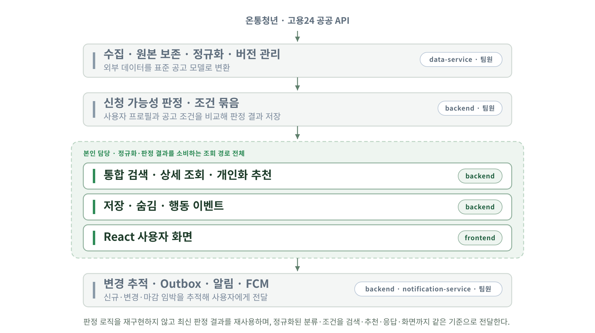
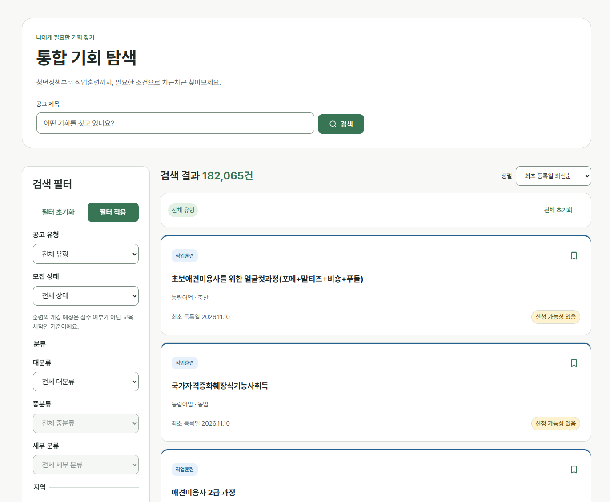
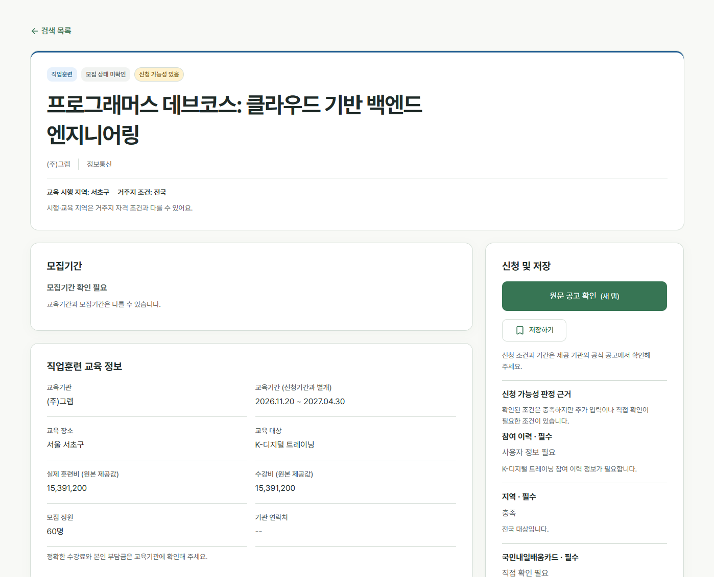
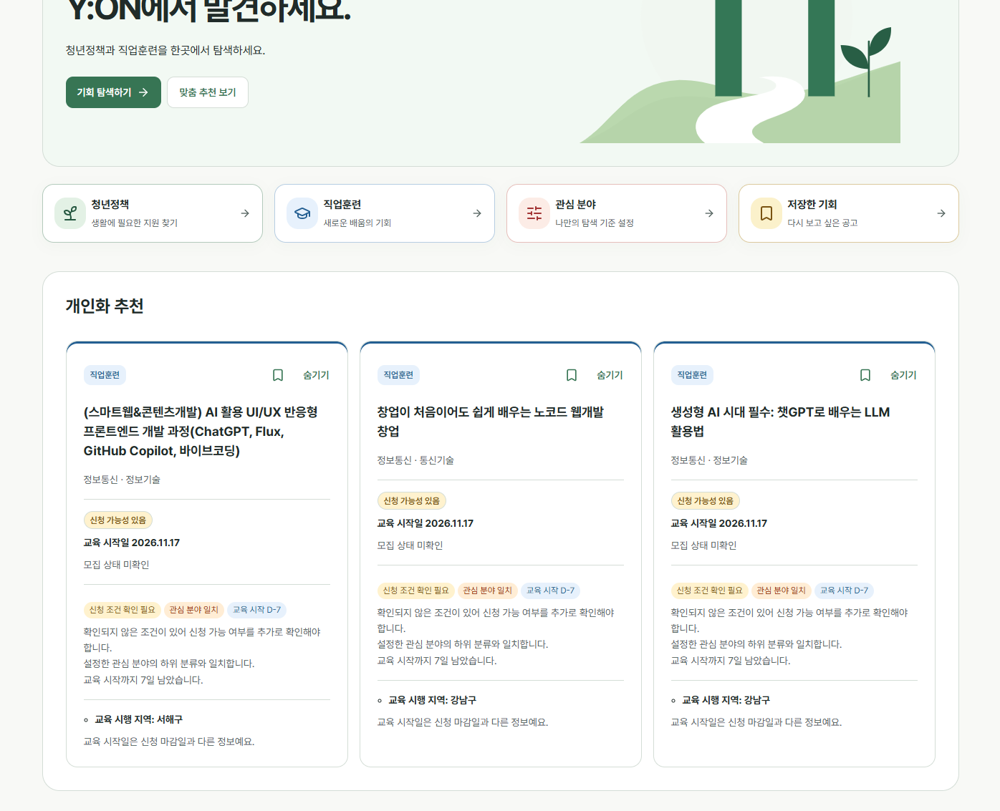
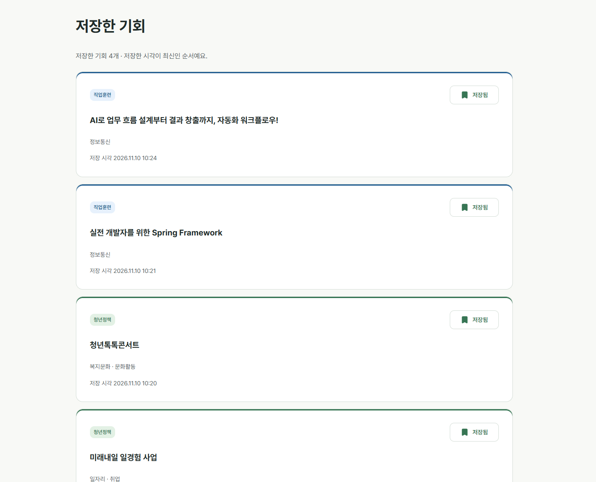
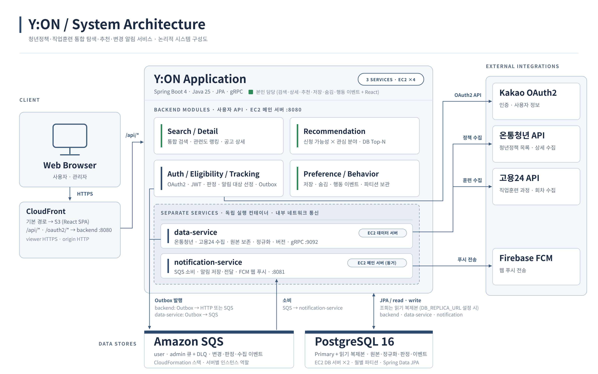
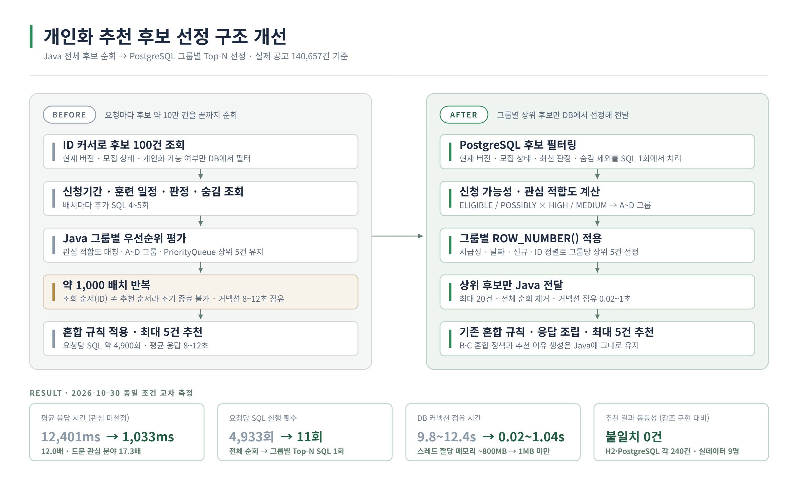

# Y:ON v1

> **사용자가 기회를 찾는 것이 아니라, 기회가 사용자를 찾아오게 한다.**


청년정책·직업훈련 정보를 통합 수집·정규화하고,   
사용자의 신청 가능성과 관심 분야를 기준으로 적합한 기회를 추천하며, 변경·마감 임박을 추적해 알리는 서비스이다.

사용자가 공고를 **발견하고, 확인하고, 관리하는** 조회 경로 전체(통합 검색·상세 조회·개인화 추천·저장·숨김)와   
그 과정의 행동 이벤트 파이프라인, React 사용자 화면을 담당했다.   
실제 공고 약 14만 건을 적재한 환경에서 검색·추천의 성능·정합성 문제를 측정·분석·개선하는 데 집중했다.

본 저장소는 프로그래머스 데브코스 최종 팀 프로젝트의 코드를 개인 포트폴리오용으로 정리한 저장소이다.

| 항목 | 내용 |
| --- | --- |
| 개발 기간 | 2026.10.06 ~ 2026.11.02 |
| 개발 인원 | 4명 |
| 담당 역할 | 통합 검색·상세 조회, 개인화 추천, 저장·숨김·행동 이벤트, React 프런트엔드 |
| 서비스 | [Y:ON 바로가기](https://du6sy07fqyo56.cloudfront.net) · [UI 시연](https://youtu.be/FhTisM51ZEc) · [API 시연](https://youtu.be/skqdlDxPpMg) |
| 원본 저장소 | [Y:ON 최종 팀 프로젝트](https://github.com/prgrms-be-devcourse/NBE11-13-final-Team03) |

> 서비스 주소는 배포 진입점이며, 상시 가동 여부는 운영 상태에 따라 달라질 수 있다.

---

## 1. Project Overview

### 1.1. 프로젝트 배경

청년 지원 정보는 온통청년·고용24 등 여러 기관에 분산되어 있고, 정책마다 분류 체계·신청 기간·자격조건이 다르다.

사용자는 각 사이트를 오가며 조건을 확인해야 하고, 공고를 발견하더라도 다음 문제를 겪는다.

- 연령·거주지역·취업 상태·소득 등 복잡한 신청 조건을 직접 해석해야 한다.
- 같은 의미의 공고가 띄어쓰기·표기 차이로 검색에서 누락된다.
- 자신에게 맞는 공고를 찾으려면 모든 공고를 직접 확인해야 한다.
- 등록 이후 조건 변경이나 마감 일정을 놓치기 쉽다.
- 공공데이터 자체가 결측·형식 불일치·자유서술 조건을 포함해 그대로 쓰기 어렵다.

Y:ON은 이 흐름을 **수집·정규화 → 신청 가능성 판정 → 검색·추천 → 변경 추적·알림**으로 연결했다.

착수 전 온통청년 API 200건을 대상으로   
데이터 품질·규칙 정규화·크롤링·LLM 조건 구조화를 비교하는 PoC를 팀 공동으로 진행했고,   
원본 보존과 규칙 기반 정규화를 기본으로 하되 복잡한 조건만 선택적으로 보완하는 방향을 정했다.

### 1.2. 담당 영역의 위치



정규화 엔진과 판정 엔진의 결과를 **소비하는 쪽**을 담당했으므로,   
판정 로직을 재구현하지 않고 최신 판정 결과를 재사용하는 계약과   
정규화된 분류·조건을 검색·추천·응답·화면까지 일관되게 전달하는 구조에 집중했다.

---

<!--
## 2. Service Preview & Key Features

### 2.1. Service Preview

| 통합 검색 | 공고 상세 |
| :---: | :---: |
|  |  |
| 필터·관련도순 정렬 · 신청 가능성 표시 | 유형별 정보 · 조건별 판정 근거 · 미검증 원문 |

| 개인화 추천 | 저장한 기회 |
| :---: | :---: |
|  |  |
| 신청 가능성·관심 분야 기반 추천과 이유 | 저장 목록 조회 및 해제 |

### 2.2. Key Features
-->

## 2. Key Features

| 영역 | 주요 기능 |
| --- | --- |
| 통합 검색 | 청년정책·직업훈련 단일 API, 키워드·유형·지역·분류·모집 상태·날짜·신청 가능성 필터, 관련도·최신순·마감 임박순 정렬 |
| 상세 조회 | 유형별 상세 정보, 신청기간/교육기간 구분, 조건별 판정 근거, 미검증 조건 원문 제공 |
| 개인화 추천 | 신청 가능성 × 관심 분야 적합도 그룹, 마감·개강 임박·신규 우선, 최대 5건과 추천 이유 |
| 저장·숨김 | 사용자별 저장·숨김 상태, 저장 목록, 저장 시점 공고 버전 기록, 추천 제외 |
| 행동 이벤트 | 노출·상세 진입·외부 링크 클릭·저장·숨김 5종 수집, 월별 파티셔닝·보관 정책, 관리자 API |
| 회원·판정 | Kakao OAuth2, 사용자 프로필·관심 분야, 신청 가능성 판정 (팀원 담당) |
| 변경 알림 | 신규·변경·마감 임박 인앱 알림 및 FCM 웹 푸시 (팀원 담당) |

---

## 3. My Contributions

**조회 경로 전체를 구현하고, 실제 데이터 규모에서 드러난 성능·정합성 문제를 측정 기반으로 개선했다.**

### 3.1. 담당 영역

| 영역 | 주요 구현 |
| --- | --- |
| Search | 통합 검색 API, 복합 필터, 검색어 정규화·후보 확장(B1), 규칙 기반 관련도 랭킹(B2), BM25 비교 |
| Search Performance | PostgreSQL JIT 컴파일 병목 분석, Criteria 서브쿼리 축소, 부분·복합 인덱스 검증 |
| Detail | 유형별 상세 응답, 경량 판정 조회 계약 도입, DTO 매핑 누락 보완 |
| Recommendation | A~D 그룹 정책·혼합 규칙, Java 전체 순회 → DB 그룹별 Top-N 선정, 참조 구현 기반 동등성 검증 |
| Preference | 저장·숨김 멱등성, 사용자 행 잠금 + UNIQUE 동시성 제어, 저장 시점 버전 기록 |
| Behavior Event | 이벤트 5종 설계, 트랜잭션 경계·예외 격리, 월별 파티셔닝·4개월 보관, 관리자 preview/execute API |
| Category Consistency | 다중 분류 정규화 테이블의 검색·추천·API 응답·화면 연동, N+1 방지 |
| Frontend | React 검색·상세·추천·저장 화면, 분류 표시 통일, 행동 이벤트 연동 |
| Testing | PostgreSQL Testcontainers 통합 테스트, 성능 측정 환경, 결과 동등성·회귀 검증 |

### 3.2. 주요 성과

| 문제 | 개선 결과 |
| --- | --- |
| 추천 요청당 후보 약 10만 건 전체 순회 | DB 그룹별 Top-N 선정으로 평균 응답 **12,401 → 1,033ms (12.0배)**, SQL **4,933 → 11회**, 커넥션 점유 약 10초 → 1초 이내 |
| 복합 검색 17초 지연 | 원인이 PostgreSQL JIT 컴파일(95%)임을 규명, 서브쿼리 51 → 21개, 인덱스 검증 후 정책+지역+마감일 중앙값 **5,647 → 406ms** |
| LIKE 검색 후보 누락 | 정규화·후보 확장으로 `청년 월세` 9 → 62건, `마음 건강` 0 → 20건, 제목 등급 우선 랭킹 적용 |
| 다중 분류 정책 검색·추천 누락 | 정규화 분류 연동으로 누락 72건 해소, 추천 SQL은 EXISTS 대비 42% 단축, API 하위 호환 유지 |
| 상세 조회 중복 SQL | 경량 판정 조회로 SQL 10 → 7회, 교차 측정 평균 응답 약 30% 단축 |
| 저장·숨김과 분석 로그의 결합 | 트랜잭션 종료 후 별도 기록으로 커넥션 중복 점유 제거, HikariCP 풀 크기 1 환경에서 검증 |

위 수치는 실제 정규화 공고 140,657건을 적재한 로컬 실험 환경에서 측정한 결과이며,   
운영 환경의 처리 용량을 의미하지 않는다.   
측정 조건은 [8. Testing & Performance](#8-testing--performance)에 정리했다.

### 3.3. 팀 내 역할 구분

| 팀원 | 담당 영역 |
| --- | --- |
| 박예은 | 통합 검색·상세, 관련도 랭킹, 개인화 추천, 저장·숨김·행동 이벤트, React 프런트엔드 |
| 신창석 | 외부 API 연동·수집, 원본 데이터·수집 이력, 스케줄러, data-service, 인프라·테스트 협업 |
| 이정균 | 공고 정규화, 조건 묶음·신청 가능성 판정, 판정 배치, 데이터·인프라 협업 |
| 정진협 | 회원·카카오 인증, 공고·사용자 변경 추적, Outbox·알림, 인앱·FCM 웹 푸시 |

`opportunity_categories` 다중 분류 데이터 모델은 팀원의 선행 구현이며,   
본인은 이를 검색·추천·API·화면에 연동하고 SQL 비용을 분석한 부분을 담당했다.   
AWS 인프라·CI/CD·읽기 복제본·백업 등은 팀 공동 영역이다.

---

## 4. Tech Stack

| Category | Stack |
| --- | --- |
| Language | Java 25 |
| Backend | Spring Boot 4, Spring MVC, Spring Data JPA, Spring Security, gRPC |
| Database | PostgreSQL 16 (Primary + 읽기 복제본), JSONB, 파티셔닝, 저장형 생성 컬럼 |
| Messaging | Transactional Outbox, Amazon SQS |
| Frontend | React 19, TypeScript, Vite, TanStack Query, Axios |
| Infrastructure | AWS EC2 ×4, CloudFront, S3, Docker Compose, Terraform |
| CI / Testing | GitHub Actions, GHCR, JUnit 5, Testcontainers, k6 |

---

## 5. System Architecture & Design

### 5.1. System Architecture



세 개의 Spring Boot 서비스가 EC2 4대(메인·데이터·DB Primary·DB 복제본)에 배치된다.

| 구성 요소 | 역할 |
| --- | --- |
| backend | 인증·프로필·판정·검색·상세·추천·선호·행동 이벤트·관리자 API. 검색·상세·추천 조회는 읽기 복제본으로 라우팅 |
| data-service | 온통청년·고용24 수집, 원본 보존, 정규화, 버전 관리. backend의 관리자 요청은 gRPC로 전달 |
| notification-service | SQS 소비, 인앱 알림 저장, FCM 웹 푸시 |
| PostgreSQL | 원본·정규화·버전·판정·선호·행동 이벤트. 행동 이벤트는 월별 파티션 |
| Amazon SQS | backend·data-service의 Outbox 발행, notification-service 소비 |

초록색으로 표시한 모듈이 본인 담당이다.

### 5.2. ERD


`opportunity_versions`가 허브다. 공고 버전에 분류·신청기간·지역·조건이 연결되고,   
조건 묶음(`condition_sets`) 단위로 판정 결과(`eligibility_set_results`)를 재사용한다.

판정 결과와 조건 묶음, 버전과 조건 묶음은 FK 없이 UNIQUE·인덱스로만 연결한다(점선).   
판정을 재계산·재사용할 때 버전 교체와 판정 갱신이 서로를 막지 않도록 느슨하게 둔 구조다.

로컬 PostgreSQL DDL과 대조한 핵심 테이블 18개 기준이며,   
전체 스키마는 `database/`와 각 서비스의 JPA 엔티티를 기준으로 한다.

### 5.3. 조회 경로의 책임 분리

```text
사용자 요청
    ↓
Search / Detail / Recommendation Service
    ├─ 최신 판정 결과만 조회 (재판정 없음)      ← EligibilityProvider
    ├─ 정규화된 분류·조건·기간 조회              ← opportunity_* 테이블
    └─ 사용자별 저장·숨김 상태 조회              ← user_opportunity_preferences
    ↓
응답 조립
```

검색·상세·추천은 자격조건을 직접 판단하지 않는다.   
정책 엔진이 저장한 최신 판정 결과를 프로필 버전·조건 묶음·유효기간 기준으로 확인해 사용하며,   
유효한 판정이 없어도 조회 요청 중 재판정하지 않는다.   
조회 API가 판정·DB 쓰기를 일으키지 않도록 책임을 나눈 결과다.

---

## 6. Core Backend Implementation

### 6.1. 통합 검색과 관련도 랭킹

`GET /api/opportunities`

청년정책과 직업훈련을 단일 API로 조회한다.   
서로 다른 필터는 AND, 같은 필터의 복수 값은 OR로 결합하고,   
유형별로 다른 분류·날짜 기준(정책은 신청 마감일, 훈련은 교육 시작일)을 적용한다.

**후보 확장(B1)**

`LOWER(title) LIKE '%keyword%'`는 띄어쓰기·표기 차이에 취약했다.   
검색어에 NFKC 정규화·소문자·공백 정리·토큰 분리·데이터로 확인된   
제한적 동의어(`파이썬/python`, `컴활/컴퓨터활용능력`)를 적용하고,   
기존 LIKE 결과를 유지한 채 정규화 제목·공백 제거 비교·복수 토큰 AND·정책 키워드 필드 매칭을 추가했다.   
제목 정규화는 요청마다 계산하지 않도록 PostgreSQL 저장형 생성 컬럼(`search_title_norm`)으로 처리했다.

**관련도 랭킹(B2)**

제목 일치 형태(완전·접두·구문·공백 제거 구문·전체 토큰 포함)를 **등급(tier)** 으로 먼저 비교하고,   
같은 등급 안에서만 정책 키워드·훈련 유형 보너스를 비교한다.   
초기에는 등급과 보너스를 하나의 점수로 합산했으나 보너스 합계가 낮은 등급을 역전시키는 문제가 있어 구조를 바꿨다.   
모집 상태는 관련성 지표가 아니므로 동점 후보의 보조 정렬에만 사용한다.

**BM25 비교 후 미채택**

같은 B1 후보 집합에서 B2와 BM25를 비교했다.   
BM25는 넓은 검색어에서 동점 후보를 더 세밀하게 나눴지만,   
평가 라벨이 B2 상위 결과에 편중돼 일관된 우위를 확인할 수 없었고 토큰 통계·갱신·동기화 비용이 추가된다.   
현재 요구사항과 운영 비용을 고려해 B2를 유지하고, 넓은 검색어의 동일 등급 내부 순위는 후속 과제로 남겼다.

### 6.2. 상세 조회와 경량 판정 계약

`GET /api/opportunities/{id}`

공통 정보는 최상위에, 유형별 정보는 `detail` 객체로 분리한다.   
고용24는 실제 모집 마감일을 제공하지 않으므로 교육 시작일을 마감일로 대체하지 않고 `UNKNOWN`으로 구분한다.

정규화된 자격조건의 원문 근거(`evidenceText`)와 검증 상태(`validationStatus`)를 함께 반환해,   
`NEEDS_REVIEW` 조건은 확정된 조건처럼 표시하지 않고 사용자가 원문을 확인할 수 있게 했다.

코드 리뷰에서 판정 Provider의 `findFreshEligibility()`가   
상세 서비스가 이미 조회한 공고 요약을 다시 조립하는 구조를 발견했다.   
상세에 필요한 판정 상태·사유·조건별 결과만 반환하는 `findFreshDecision()`과 `EligibilityDecision` DTO를 추가해   
불필요한 SQL 3회를 제거했다.   
최신성 판정 SQL은 그대로 재사용하고, 기존 계약은 다른 호출처 영향을 확인한 뒤 정리하도록 남겼다.

### 6.3. 개인화 추천

`GET /api/users/me/recommendations`

규칙 기반 필터링 + 카테고리 기반 콘텐츠 추천 + 시간 우선순위를 선택했다.   
초기 행동 데이터가 없고, 신청 가능성이 추천의 전제 조건이며, 추천 이유를 설명할 수 있어야 했기 때문이다.

| 그룹 | 신청 가능성 | 관심 적합도 |
| --- | --- | --- |
| A | `ELIGIBLE` | `HIGH` (중분류·NCS 세부 일치) |
| B | `ELIGIBLE` | `MEDIUM` (대분류·NCS 상위 일치) |
| C | `POSSIBLY_ELIGIBLE` | `HIGH` |
| D | `POSSIBLY_ELIGIBLE` | `MEDIUM` |

A 그룹을 최우선으로 채우고,   
B·C는 고정 비율 대신 남은 자리와 후보 수에 따라 B를 우선하되 C를 최소 1건 포함하는 혼합 규칙을 적용했다.   
그룹 안에서는 마감·개강 임박 → 날짜 → 신규 등록 → 공고 ID 순으로 정렬해 결과를 결정적으로 만들었다.   
적합한 후보가 부족하면 5건을 강제로 채우지 않는다.

최종 구현에서는 후보 필터링·적합도 계산·그룹 구성·정렬·그룹별 상위 5건 선정을 PostgreSQL 네이티브 SQL 1회로 처리하고,   
Java는 혼합 규칙과 응답 조립만 담당한다. 구조 변경 과정은 [7.1](#71-추천-요청당-후보-10만-건-전체-순회)에서 다룬다.

### 6.4. 저장·숨김

| 기능 | API |
| --- | --- |
| 저장 / 해제 | `POST` / `DELETE /api/opportunities/{id}/save` |
| 숨김 / 해제 | `POST` / `DELETE /api/opportunities/{id}/hide` |
| 저장 목록 | `GET /api/users/me/saved-opportunities` |

저장(재확인용)과 숨김(추천 제외용)은 독립 상태다. 숨긴 공고도 검색·상세에서는 보이고,   
저장 여부는 추천 가중치가 아니라 응답의 상태 정보로만 쓴다.

같은 요청을 반복해도 최종 상태가 같도록 멱등하게 처리하고,   
동시 요청은 사용자 행 잠금과 `(user_id, opportunity_id)` UNIQUE 제약으로 중복 생성을 막는다.   
저장 시점의 공고 버전을 `saved_version_id`에 기록해 이후 변경 추적과 연결할 수 있게 했다.

### 6.5. 사용자 행동 이벤트와 보관 정책

`POST /api/opportunities/{id}/events`

| 이벤트 | 기록 주체 | 기준 |
| --- | --- | --- |
| `IMPRESSION` | 프런트엔드 | 추천 카드가 실제 화면에 노출 (API 응답 ≠ 노출) |
| `DETAIL_VIEW` | 프런트엔드 | 상세 화면 진입 |
| `EXTERNAL_LINK_CLICK` | 프런트엔드 | 원문·신청·참고 링크 클릭 (`linkType` 구분) |
| `SAVE` / `HIDE` | 백엔드 | 상태 전환이 실제로 성공한 경우만 |

`SAVE`/`HIDE`는 클라이언트가 직접 등록할 수 없다.   
버튼 클릭과 성공한 상태 전환을 구분하기 위해 상태를 바꾼 백엔드가 기록한다.   
외부 링크 클릭은 신청 완료가 아니므로 이름과 지표에서 구분했다.

이벤트 누적에 대비해 `received_at` 기준 월별 파티션과 최근 4개월 보관 정책을 구현했다.   
스케줄러는 기본 비활성이고 활성화해도 기본값은 dry-run이며,   
advisory lock·실제 날짜 범위 기준 삭제·DEFAULT 파티션 보호·파티션별 트랜잭션을 적용했다.   
관리자 API는 preview에서 발급한 `planToken`을 execute에서 재검증해 그 사이 파티션 구성이 바뀌면 실행을 거부한다.

---

## 7. Technical Challenges

### 7.1. 추천 요청당 후보 10만 건 전체 순회

#### 문제 상황

실제 정규화 공고 140,657건을 적용하자 추천 요청 한 번에 **8~10초**가 걸렸다.

```text
ID 커서로 후보 100건 조회
    ↓
신청기간 · 훈련 일정 · 판정 · 숨김 조회
    ↓
Java 그룹별 우선순위 평가
    ↓
약 1,000배치 반복 (후보 102,859건)
    ↓
최대 5건 추천
```

최대 5건을 반환하기 위해 약 10만 건을 끝까지 순회하며, 배치마다 SQL 4~5회가 반복돼 요청당 **약 5,000회**가 실행됐다.   
읽기 전용 트랜잭션이 전체 탐색 동안 유지돼 DB 커넥션을 **8 ~ 12초** 점유했다.

#### 원인 분석

응답 시간 9,771ms를 분해하면 후보·기간·일정 조회 67%, 판정 조회 19%, 숨김 조회 12.5%였고 Java 매칭·정렬은 1%였다.   
`EXPLAIN ANALYZE`로 본 개별 SQL은 짧았다.   
문제는 무거운 쿼리 하나가 아니라 **짧은 SQL의 DB 왕복이 수천 번 누적되는 구조**였다.

단순 조기 종료는 불가능했다. 후보 조회 순서(ID)와 추천 순서(그룹·시급성)가 달라,   
앞쪽에서 5건을 확보해도 뒤쪽에 더 높은 우선순위의 A 그룹 공고가 있을 수 있었다.

#### 실패한 시도

- **숨김 조회 일괄화**

  배치마다 반복하던 숨김 조회를 요청 시작 시 한 번으로 바꿨다.   
  SQL은 1,028회 줄었지만 응답 시간은 시나리오별로 −3%~+5% 사이에서 엇갈려 일관된 개선이 없었다.

- **배치 크기 확대 (100 → 500 · 1,000)**

  SQL 횟수는 줄었으나 응답이 **20~25초로 악화**됐다.   
  `EXPLAIN` 결과 PostgreSQL이 `LIMIT` 증가에 따라 PK 순서 탐색 대신 넓은 범위를 정렬하는 계획을 선택했다.   
  데이터 분포와 커서 위치에 따라 달라지는 방법이라 채택하지 않았다.

두 실험으로 **SQL 횟수 감소만으로는 전체 순회 구조를 해결할 수 없다**는 점이 분명해졌다.

#### 대안 검토

| 대안 | 장점 | 한계 |
| --- | --- | --- |
| DB에서 후보 축소 후 Java 선정 | 기존 Java 로직 대부분 재사용 | 약 10만 건의 훈련 공고가 소수 조건 묶음을 공유해, 신청 가능성으로 걸러도 후보가 충분히 줄지 않음 |
| **DB에서 그룹별 Top-N 선정** | Java 전체 순회 제거 | 추천 규칙을 SQL로 이전, 동등성 검증 필요 |

#### 해결

후보 필터링·관심 적합도·A~D 그룹·정렬·그룹별 상위 5건 선정을 `ROW_NUMBER()` 기반 네이티브 SQL 1회로 이전하고,   
Java에는 B·C 혼합 규칙과 응답 조립만 남겼다.



그룹별 상위 5건으로 자른 것은 임의의 축소가 아니다. 기존 Java 구현도 `PriorityQueue`로 그룹당 5건만 보관했으므로,   
같은 우선순위 기준을 DB에서 계산하도록 옮긴 것이다.

운영 코드를 바꾸기 전에 실데이터와 합성 사용자 9명, 무작위 Fixture 240건으로   
새 SQL의 선정 결과가 기존과 일치하는지 먼저 확인했다.

#### 검증

| 시나리오 | 개선 전 | 개선 후 | SQL |
| --- | --- | --- | --- |
| 관심 분야 미설정 | 12,401ms | 1,033ms (12.0배) | 4,933 → 11 |
| 대중적 관심 분야 | 10,891ms | 721ms (15.1배) | 4,164 → 11 |
| 드문 관심 분야 | 9,830ms | 568ms (17.3배) | 3,951 → 11 |
| 숨김 2만 건 | 11,819ms | 1,041ms (11.4배) | 4,933 → 11 |

DB 커넥션 점유 9.8 ~12.4초 → 0.02 ~1.04초, 요청 스레드 할당 메모리 약 780 ~960MB → 1MB 미만.

기존 전체 순회 구현을 `RecommendationFullScanReference`로 보존하고,   
H2·PostgreSQL 무작위 Fixture 각 240건, 실데이터 합성 사용자 9명, HTTP 응답 본문 비교에서 불일치 0건을 확인했다.   
SQL 정렬 방향을 일부러 뒤집었을 때 테스트가 실패하는지도 확인해 테스트의 탐지력을 검증했다.

#### 검토 후 미적용 — `work_mem`

일부 정렬이 디스크 임시 파일을 쓰는 것을 확인해 `work_mem`을 4 → 32MB로 올려 봤다.   
SQL 단독 시간은 줄었지만 API 응답은 ±5% 안에서 흔들렸고 p99는 일부 악화됐다.   
동시 요청 시 메모리 사용만 늘리는 변경이라 적용하지 않았다.

#### 남은 트레이드오프

응답 시간의 93~96%가 여전히 Top-N SQL 1회에 집중되고, 추천 규칙이 SQL과 Java 참조 구현에 이중 존재한다.   
성능을 얻는 대신 유지보수 비용을 받아들이고, 동등성 테스트로 변경 위험을 통제하는 선택을 했다.

### 7.2. 복합 검색 17초 지연 — PostgreSQL JIT 컴파일

#### 문제 상황

140,657건에서 단순 최신순 검색은 0.1초였지만, "청년정책 + 서울 + 마감일 우선 정렬"은 **중앙값 17.5초**였다.

#### 원인 분석

1. Hibernate SQL 확인 → 요청당 목록 1회 + COUNT 1회. **N+1이 아니었다.**
2. 생성된 SQL 확인 → 마감일 정렬의 `ORDER BY`에 모집 상태 판정용 EXISTS 서브쿼리가 **51개** 전개돼 있었다.   
Criteria 식을 Java 변수로 재사용해도 Hibernate는 참조 횟수만큼 같은 식을 다시 전개했다.
3. `EXPLAIN ANALYZE` → 실행 14.2초 중 **13.5초가 JIT 컴파일**(함수 2,490개).   
서브쿼리 전개로 예상 비용이 JIT 임계값을 넘어, 데이터 처리보다 컴파일에 시간을 쓰고 있었다.   
같은 SQL을 `jit=off`로 실행하면 15,891ms → 429ms였다.

#### 해결

- **Criteria 식 재구성**: 검색 전용 네이티브 SQL 재작성도 검토했지만 동적 필터와 상태 판정 규칙을 중복 구현해야 해   
기존 Specification 계약을 유지하는 쪽을 택했다.   
날짜·상태 판정식의 재전개를 줄이고 `Nulls.LAST`로 NULL 판정식을 대체해   
서브쿼리 51 → 21개, JIT 함수 2,490 → 630개, API 중앙값 12,745 → 5,494ms.
- **인덱스 검증**: 전국 대상 부분 인덱스, 유효 신청기간 부분 인덱스, 유형·등록일 복합 인덱스를 단독·조합으로 비교했다.   
신청기간 인덱스는 단독으로는 일부 시나리오를 악화시켰지만 조합에서 효과가 났다.   
정책+서울+마감일 중앙값 228 → 104ms(JIT OFF),   
청년정책+지역 72 → 25ms. INSERT +51%의 쓰기 비용은 별도 측정해 트레이드오프로 기록했다.
- 후속 측정에서 정책·지역·마감일 정렬 중앙값 **5,647 → 406ms**.

#### 폐기한 대안

후보 선별 조건을 SQL 앞단에 추가하면 플래너 예상 비용이 낮아져 JIT가 꺼졌다.   
그러나 JIT를 끈 같은 조건에서 비교하면 실제 DB 작업은 **3~6배 느려졌다**.   
큰 중간 집합을 만든 뒤 조건을 다시 평가하는 중복 처리 때문이었다.   
**예상 비용 감소 ≠ 실제 성능 개선**을 확인한 사례다.

### 7.3. 저장·숨김과 행동 이벤트의 트랜잭션 경계

#### 문제 상황

저장·숨김은 핵심 상태 변경이고 행동 이벤트는 분석용 부가 데이터다.   
이벤트 INSERT 실패가 저장·숨김을 실패시키면 안 되고, 상태가 실제로 바뀐 경우에만 기록해야 했다.

#### 초기 설계의 함정

`@TransactionalEventListener(AFTER_COMMIT)` + `@Transactional(REQUIRES_NEW)` 조합으로 설계했다.

그런데 **커밋이 완료된 시점과 JDBC 커넥션이 반환된 시점은 다르다.**   
`AFTER_COMMIT` 리스너가 실행될 때 이전 트랜잭션의 자원 정리가 아직 끝나지 않았을 수 있어,   
기존 커넥션을 쥔 채 `REQUIRES_NEW`가 두 번째 커넥션을 요청한다.   
동시 요청이 풀을 점유하면 대기·타임아웃으로 이어질 수 있었다.

#### 대안 검토

| 대안 | 장점 | 한계 |
| --- | --- | --- |
| 커넥션 풀 증설 | 간단 | 동시 점유 구조 유지 |
| 비동기 처리 | 요청 흐름 분리 | 실행기·종료·유실 관리 |
| Outbox·MQ | 전달 신뢰성 | 분석용 로그에 과한 운영 복잡도 |
| **트랜잭션 종료 후 별도 기록** | 동시 점유 위험 제거 | 호출 경계 의존, 유실 가능성 |

#### 해결

`PreferenceService.save()/hide()`가 실제 상태 변경 여부를 반환하고,   
트랜잭션이 완전히 종료된 뒤 Controller가 변경된 경우에만   
`PreferenceBehaviorRecorder`를 호출해 `REQUIRES_NEW`로 기록한다.   
예외는 Recorder에서 격리해 204 응답을 유지한다.

```text
PreferenceController
    ↓
PreferenceService.save() / hide()
    ├─ 사용자 잠금 · 상태 전환
    └─ COMMIT · 자원 반환
    ↓
상태 변경 여부 확인
    ↓
PreferenceBehaviorRecorder
    └─ REQUIRES_NEW · SAVE/HIDE INSERT · 예외 격리
```

#### 검증

PostgreSQL Testcontainers 36건: 최초 전환 시만 기록, 동일 상태 재요청 시 미생성, Preference 롤백 시 미기록,   
이벤트 INSERT 실패 시 상태 유지, **HikariCP 최대 풀 크기 1 환경에서 정상 기록**(해당 경로에서 추가 커넥션 대기가 없음을 확인).

#### 수용한 트레이드오프

커밋 후 이벤트 저장 전 서버가 종료되면 이벤트는 유실된다.   
분석용 로그라는 성격과 운영 단순성을 우선해 수용했고, 전달 보장이 필요한 알림 Outbox와는 별도 정책으로 구분했다.

합성 이벤트 200만 건 환경에서 INSERT 자체는 0.4~0.6ms로 가벼웠고   
비동기 처리의 추가 이점은 검증되지 않아 도입하지 않았다.

### 7.4. 다중 분류 정합성 — 정확성을 위해 비용을 받아들인 판단

#### 문제 상황

청년정책 대·중분류가 `일자리,교육` 같은 쉼표 문자열로 저장돼 있어 단일 값 비교 기반 검색·추천이 다중 분류 정책을 누락했다.

| 항목 | 결과 |
| --- | --- |
| 다중 분류 정책 | 3,614건 중 130건 (3.6%) |
| `일자리 + 취업` 검색 | 833 → 905건, **72건 누락** |
| 동일 분류명 `교육･직업훈련` 유형 오표시 | 353건 |

#### 해결

팀원이 정규화한 `opportunity_categories`를 검색·추천·API 응답·화면 네 곳에 연동했다.

- **검색**: 현재 버전의 분류 행 기준으로 매칭하고, 같은 행에 속한 대·중분류 쌍만 허용해 교차 매칭과 공고 중복을 막았다.
- **추천**: `CASE` 내부 EXISTS로 먼저 구현했으나 실행 계획에서 필터 푸시다운이 막혀 2,643 → 4,985ms로 악화됐다.   
관심 일치 분류를 버전별로 사전 집계해 JOIN하는 구조로 바꿔 2,878ms.   
EXISTS 대비 42% 단축이지만 기존 단일 비교보다 +235ms이며, 누락을 해결하는 정확성 비용으로 수용했다.   
시드 40개 동등성 불일치 0.
- **API**: 기존 `category`·`subCategory`를 유지하고 정규화된 `categories` 배열을 추가해 하위 호환을 지켰다.   
분류 조회는 페이지 단위 일괄 조회로 제한해, 공고 1건과 4건 조회 시 SQL 수가 같음을 확인했다.
- **유형 충돌**: 분류명을 바꾸지 않고 `opportunityTypes`·`categoryType` 메타데이터로 유형을 구분했다.

#### 배운 점

데이터 정규화는 저장 단계에서 끝나지 않는다.   
검색·추천·API·화면이 같은 기준을 쓰지 않으면 사용자에게는 다른 데이터다.   
또한 다른 담당자의 변경이 내 측정값의 전제를 바꿨을 때,   
확정했던 수치를 "당시 조건"으로 격하하고 관계를 남기는 것이 정직한 기록이었다.

---

## 8. Testing & Performance

### 8.1. 측정 환경

| 영역 | 데이터 | 환경 |
| --- | --- | --- |
| 검색·추천 | 실제 정규화 공고 140,657건 (정책 3,614 · 훈련 137,043) | 운영·개발과 분리한 Docker PostgreSQL 16, 실제 판정 엔진으로 생성한 합성 사용자 |
| 상세 조회 | 소규모 테스트 공고 | Testcontainers, worktree 교차 측정 3쌍 |
| 행동 이벤트 | 합성 사용자 1만 명 · 이벤트 200만 건 | Docker PostgreSQL, 동시 사용자 1·10·50 |

추천 개선율은 2026-10-30 동일 조건에서 개선 전후 코드를 번갈아 실행한 값이다.   
최초 Before(10-29)와는 기준일·후보 수가 달라 직접 비교하지 않았다.

### 8.2. 정합성 검증

- 추천: 참조 구현 대비 H2·PostgreSQL 무작위 Fixture 각 240건, 실데이터 사용자 9명, HTTP 응답 본문 비교 불일치 0
- 다중 분류 적용 후: 시드 40개 추천 결과 불일치 0
- 상세 조회: 8개 시나리오 × 6회 응답 본문 동일, 최신성 판정 SQL 변경 전후 동일
- 검색: 실제 HTTP API 59개, 브라우저 37개 검증 항목 통과
- PR #138 기준 백엔드 테스트 1,205개 실행·실패 0, 프런트엔드 367건 통과

### 8.3. 검증 범위

| 확인한 것 | 확인하지 않은 것 |
| --- | --- |
| 실데이터 14만 건에서 검색·추천의 응답 시간·SQL 수·실행 계획 (단일 또는 동시 4요청) | 운영 환경 평균·p95·p99, 목표 동시 사용자 수 기준 처리량 |
| 개선 전후 추천 결과·응답 동등성 | 검색·추천 동시 실행 시 커넥션 풀 대기, CPU·메모리, 오류율 |
| 행동 이벤트 INSERT 비용, 풀 크기 1 경로의 기록 성공 | `categories` 응답 추가 이후 전체 API 응답 시간 재측정 |
| 신규 인덱스의 쓰기 비용 (임시 테이블 실험) | 운영 DB의 파티션 전환·보관 정리 활성화 여부 |

목표 사용자 수나 요구 응답 시간을 사후에 설정해 달성했다고 주장하지 않는다.   
왼쪽 열은 측정값이고, 오른쪽 열은 다음 검증 과제다.

---

## 9. Limitations & Evolution

### 추천 SQL의 DB 내부 비용

관심 분야를 설정하지 않은 사용자는 약 9.7만 행을 정렬하고 디스크 임시 파일 약 21MB를 쓴다.   
데이터가 늘면 관심 분야 필터를 앞단으로 옮기거나 후보 탐색 방식을 바꿀 필요가 있다.   
custom plan 대비 generic plan이 2~5배 느린 시나리오도 있어 실행 계획 변화를 관찰해야 한다.

### 검색 품질의 남은 한계

`AI`처럼 넓은 검색어는 같은 제목 등급에 수천 건이 몰려 등록 시각이 순서를 결정한다.   
훈련과정 회차가 개별 공고로 저장돼 상위 결과가 편중되는 문제도 있다.   
평가 라벨이 B2 상위 결과에 편중돼 BM25 대비 품질 우위를 확정하지 못했다.

### 행동 이벤트 활용

현재는 수집·보관까지만 구현했고 추천 순위에 반영하지 않는다.   
행동 기반 재정렬을 도입하려면 DB Top-N 선정 단계에도 정렬 기준을 넣어야 하므로   
SQL·Java 비교기·참조 구현·동등성 테스트를 함께 바꿔야 한다.   
노출 ID가 없어 개별 노출과 후속 행동을 정확히 연결하기 어렵고, `source`는 클라이언트 전달값이라 분석용으로만 쓴다.

### 운영 검증

k6와 EC2 t3.small 자원 제한을 모사한 측정 환경(`perf/`)은 구성했지만 반복 측정은 실행하지 않았다.   
운영 p95·p99와 동시 접속 한계는 후속 과제다.

---

## 10. References

### Related Repositories

| Repository | Description |
| --- | --- |
| [Y:ON 최종 팀 저장소](https://github.com/prgrms-be-devcourse/NBE11-13-final-Team03) | 팀 프로젝트 원본 |
| [Y:ON v1](https://github.com/dPdms21/yon-v1) | 최종 프로젝트 개인 포트폴리오 |

### Related Pull Requests

| PR | 내용 |
| --- | --- |
| [#102](https://github.com/prgrms-be-devcourse/NBE11-13-final-Team03/pull/102) | 검색 SQL·JIT 분석 및 인덱스 개선 |
| [#112](https://github.com/prgrms-be-devcourse/NBE11-13-final-Team03/pull/112) | 검색 후보 확장·관련도 랭킹·BM25 비교 |
| [#115](https://github.com/prgrms-be-devcourse/NBE11-13-final-Team03/pull/115) | 상세 조회 중복 SQL 제거 |
| [#116](https://github.com/prgrms-be-devcourse/NBE11-13-final-Team03/pull/116) | 추천 DB Top-N 구조 개선 |
| [#130](https://github.com/prgrms-be-devcourse/NBE11-13-final-Team03/pull/130) | 행동 이벤트 수집·보관 정책 |
| [#134](https://github.com/prgrms-be-devcourse/NBE11-13-final-Team03/pull/134) | 다중 분류 검색·추천 매칭 |
| [#138](https://github.com/prgrms-be-devcourse/NBE11-13-final-Team03/pull/138) | 정규화 분류 응답 및 화면 표시 |

### Author

**박예은 | Yeeun Park**

Backend Developer

GitHub: [dPdms21](https://github.com/dPdms21)